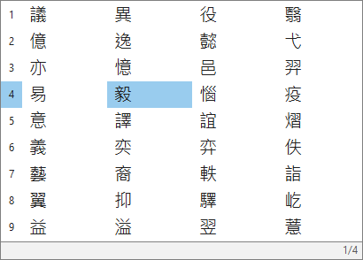

# E-IME (Enhanced IME)

**本專案的全部程式碼均由 AI 生成。作者沒有手寫任何一行程式碼，僅指示 AI 生成。**

**E-IME 是微軟注音的模仿品。** 目標是重現它的整句組字、回頭選字與中英切換操作，再加入可編輯詞庫、四欄候選與繁簡切換。使用 C++20 與 Windows TSF 實作。

[](https://github.com/vmjoejoe3396408-afk/E-IME/actions/workflows/ci.yml)
[](CMakeLists.txt)
[](#支援範圍)
[](LICENSE)

**目前為公開原始碼預覽版。** 主線為 `master`，CMake 版本為 `0.4.0`；目前需自行編譯，尚未提供預編譯安裝套件。實際宿主相容性、高 DPI 與跨裝置同步仍在驗證中。

## 候選窗預覽



20px 候選字、30px 列高，左側共用序號，最多四欄／36 項；直角細框、整格藍底選取，移除陰影。上圖為目前繪製程式產生的預覽，實際字體與尺寸受宿主及螢幕環境影響。繁簡切換另於滑鼠游標上方顯示約 1.2 秒的小型提示。

## 開發方式

程式碼的生成方式與第三方資料來源分別記錄於 [實作與來源紀錄](docs/IMPLEMENTATION_PROVENANCE.md) 及 [第三方聲明](THIRD_PARTY_NOTICES.md)。

## 想改善什麼

以微軟注音為模仿對象，先做出接近的操作，再調整詞庫、候選布局和快速輸入容錯。

| 使用痛點 | E-IME 的做法 |
| --- | --- |
| 詞庫不合自己的用語，需要加入新詞或專業詞彙 | 使用 UTF-8 純文字詞庫與自訂詞檔，可直接編輯；另有二進位快取減少重複解析。 |
| 換裝置後希望保留個人選字學習 | 每個輸入法實例各寫一份學習日誌，可由外部私人雲端硬碟傳送；跨機實際傳輸仍待驗證。 |
| 候選字太小、選項太少，想調整顯示方式 | 候選字使用 20px 字級、30px 列高；目前版本可展開最多四欄、每頁 36 項。樣式目前需修改原始碼。 |
| 長句中某個詞選錯，想回頭改字 | 移動組字游標、開啟候選並鎖定手選詞，其餘未鎖定部分重新解碼；選字後仍能再次改選。 |
| 快速打字時聲韻或聲調落鍵順序錯亂 | 支援聲韻槽位重排；目前版本另對尚無詞庫匹配的已結音音節，嘗試補入晚到的介音或韻母。 |
| 某些按鍵行為或輸入 bug 需要自行修正 | 本專案程式碼採 MIT 授權，可重建 DLL、執行測試並用版本目錄部署。詞庫與映射資料另依第三方授權分發。 |

模仿對象是微軟注音的操作與介面行為。系統整合使用公開的 TSF／Win32 API，詞庫及繁簡字元映射來自開源專案。實作依據與資料來源見 [實作與來源紀錄](docs/IMPLEMENTATION_PROVENANCE.md) 及 [第三方聲明](THIRD_PARTY_NOTICES.md)。

## 建置與安裝

需要 Windows 10／11 x64、Git、PowerShell 7、CMake 3.20+，以及 Visual Studio 2022 的「使用 C++ 的桌面開發」工具組。MinGW-w64 GCC 13+ 與 Ninja 也可建置。

在 PowerShell 7 取得主線：

```powershell
git clone --branch master https://github.com/vmjoejoe3396408-afk/E-IME.git
cd E-IME
```

以下使用 MSVC；安裝器需要時會要求管理員權限：

```powershell
cmake -S . -B build-msvc -G "Visual Studio 17 2022" -A x64
cmake --build build-msvc --config Release
ctest --test-dir build-msvc -C Release --output-on-failure
pwsh -File .\scripts\install.ps1 -SourceDll .\build-msvc\Release\eime_tip.dll
```

一般建置直接使用庫內詞庫，不需要 Python 或重新下載資料。請確認每個步驟成功後再繼續。完整 MinGW 步驟、更新、停用與移除方式見 [換機與安裝指南](docs/SECOND_DEVICE_TEST.md)。

安裝後開啟新的記事本，以 `Win+Space` 選取 E-IME。**請保留專案目錄**：安裝器會複製 DLL 至本機版本目錄，但詞庫仍指向專案的 `data/`。

## 基本操作

| 操作 | 按鍵 |
| --- | --- |
| 輸入「你好」 | 中文模式輸入 `su3cl3`，再按 Enter |
| 開啟候選／確認候選 | ↓／數字 1–9 或 Enter；選字後再按 Enter 才提交整句 |
| 展開多欄候選 | 候選多於 9 項時按 →；←／→ 切欄，PgUp／PgDn 翻頁 |
| 切換中英 | 單按 Shift |
| 切換繁簡 | Ctrl+Shift+F |
| 指定繁體／簡體 | **右 Ctrl＋右 Shift＋T／S** |
| 逗號／句號／頓號 | Ctrl+,／Ctrl+.／Ctrl+' |

目前版本使用無陰影的直角淺色候選窗、實線組字底線，錯誤提示預設靜音。繁簡模式以滑鼠游標上方的小型提示顯示，候選窗不常駐 `[繁]`／`[簡]` 標籤。更多標點、選字細節與容錯限制見 [操作指南](docs/USAGE.md)。

## 支援範圍

- 目前針對 Windows x64 與標準大千排列；未提供 32 位元 WoW64 模組或其他鍵盤排列。
- 解碼以詞頻、局部鎖定及少量固定字詞搭配規則為主，尚無訓練式語言模型；不保證所有句子都能自動改對。
- 每次 CTest 有 5 組測試，核心套件含 15 項模組；TSF 自動測試使用 mock 宿主。自動測試通過不能替代記事本、瀏覽器、編輯器與多螢幕的實機觀察。
- 個人日誌與快取不經 Git 傳送；`data/custom_words.txt` 是已追蹤的公開範例，加入私人詞彙後請留意不要提交。
- 歷次測試的版本、範圍及證據見 [測試索引](testbench/README.md)，目前待驗證事項見 [研發紀錄與路線](docs/PROCESS_AND_ROADMAP.md)。

## 回報問題

請在 [GitHub Issues](https://github.com/vmjoejoe3396408-afk/E-IME/issues) 提供 Windows 版本、宿主程式、螢幕縮放、commit 或版本、實際按鍵順序，以及預期／實際結果。畫面與日誌請先移除私人輸入內容。

## 文件與原始碼

[文件索引／分支差異](docs/README.md) · [操作指南](docs/USAGE.md) · [安裝與換機](docs/SECOND_DEVICE_TEST.md) · [系統架構](docs/ARCHITECTURE.md) · [更新紀錄](docs/CHANGELOG.md)

核心邏輯在 `engine/include/`，TSF 外殼在 `tsf/`，候選窗在 `ui/`，學習日誌在 `sync/`；安裝腳本、資料產生器與測試分別位於 `scripts/`、`tools/`、`tests/` 及 `testbench/`。

本專案程式碼採 [MIT](LICENSE)；libchewing 衍生詞庫採 LGPL-2.1-or-later，OpenCC 衍生映射採 Apache-2.0。完整文本與作者聲明隨庫保存於 [LICENSES](LICENSES/)，使用範圍及重建方式見 [THIRD_PARTY_NOTICES.md](THIRD_PARTY_NOTICES.md)。
