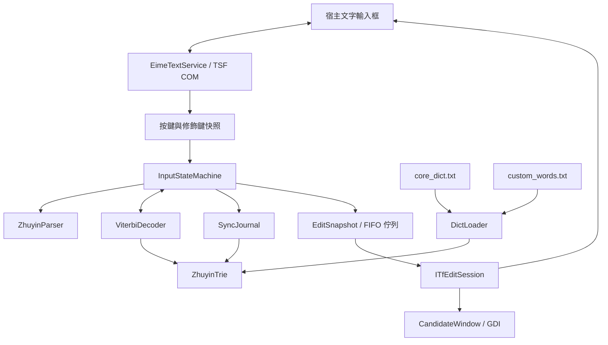

# 系統架構

適用：`feature/aggressive-correction`（功能基準 `9b73ae7`）。命名空間為 `eime`，系統元件為 `eime_tip.dll`。使用行為見 [操作指南](USAGE.md)，與主線的差異見 [分支對照](README.md)。

## 模組與資料流



| 模組 | 實作位置 | 職責 |
| --- | --- | --- |
| 注音解析 | [zhuyin.h](../engine/include/zhuyin.h) | 大千按鍵映射、聲韻調解析及標點對照 |
| 字典樹 | [trie.h](../engine/include/trie.h) | 詞彙前綴查詢、精確查詢、基礎詞頻與個人權重 |
| 解碼 | [viterbi.h](../engine/include/viterbi.h) | 音節切詞、手選區段約束、詞長及搭配評分 |
| 組字狀態 | [input_state_machine.h](../engine/include/input_state_machine.h) | 游標、音節、literal 字元、候選分頁與模式切換 |
| 詞庫載入 | [dict_loader.h](../engine/include/dict_loader.h) | UTF-8 TSV、中文路徑及二進位快取 |
| 個人學習 | [sync_journal.h](../sync/include/sync_journal.h) | 每實例日誌、累計值合併及壓縮 |
| Windows 整合 | [text_service.cpp](../tsf/text_service.cpp)、[register.cpp](../tsf/register.cpp) | TSF 回呼、組字範圍、登錄及游標座標 |
| 候選窗 | [candidate_window.cpp](../ui/candidate_window.cpp) | 無啟用浮窗、多欄繪製、頁碼及繁簡短暫提示 |

## 按鍵到組字

`EimeTextService` 實作 `ITfTextInputProcessor`、`ITfKeyEventSink`、`ITfCompositionSink` 及 `ITfDisplayAttributeProvider`；目前並未實作 `ITfTextInputProcessorEx`。

`OnTestKeyDown` 判斷是否攔截並保存按鍵快照，`OnKeyDown` 盡可能沿用同次事件的內容。Ctrl／Shift 有左右鍵追蹤；此分支也讀取 `GetKeyState` 與 `GetAsyncKeyState`。這些路徑仍需在實體鍵盤、遠端及快速連打情境下測試，mock 不涵蓋所有事件時序。

狀態機有 `Idle`、`Composing`、`CandidateOpen` 三種狀態。完成的音節與插入的標點／英數以槽位保存；literal 槽位可以和注音組字一起移動、刪除及提交。手動選字建立 `PinnedSegment`，候選 Enter 只選字，組字 Enter 才提交文字。

本分支增加提早聲調補全：僅對未手選鎖定、原音節無精確匹配、補入聲韻後能匹配的情況回填前一槽位。它依賴目前詞庫的有效性判斷，不是任意次序都能修正。

## 解碼與學習評分

`ViterbiDecoder::decode()` 以音節位置作動態規劃，從 Trie 枚舉前綴候選；不允許一般候選跨越手動鎖定區段。鎖定轉移使用指定文字，無詞庫匹配時以原生注音保底。

一般候選的分數為：

```text
前段分數 + 候選 log_prob + 詞長加成 + 字詞搭配加減分
```

- `log_prob` 已納入個人學習權重。Trie 以 `base_frequency + user_boost × 250000` 計算有效詞頻；不應再把使用者加成當成另一個獨立項目重複相加。
- 長度至少 2 的詞，加成為 `2.2 × (length - 1)`。
- `compute_transition_score()` 是人工列出的有限搭配規則，例如「的／得」、「在／再」、「已／以」、「做／作」，未載入訓練出的 bigram 機率表。
- 每個音節位置只保留一條最佳前段路徑，再用該路徑的前詞評分；不是保留完整「位置 × 前詞」狀態的 bigram 搜尋，不能據此宣稱所有上下文組合都有全域最優保證。

## TSF 編輯與候選窗

組字變化產生包含文字、游標、候選及模式的 `EditSnapshot`，送入 FIFO 佇列。`drain_edit_sessions()` 在宿主允許寫入時套用，世代編號用來排除停用或重新啟用前的過期回呼。

一般組字採 `TF_LS_SOLID` 實線，目標區段採粗實線。文字位置需在 UTF-8、UTF-16 與音節槽位之間轉換。候選窗位置優先參考 TSF 文字範圍，再回退至 Win32 caret 或作用中視窗座標。

候選窗使用 `WS_EX_NOACTIVATE`、`SWP_NOACTIVATE` 與 `WM_MOUSEACTIVATE` 處理避免啟用浮窗；繪圖為 GDI 雙緩衝。此分支使用直角、24px 候選字、38px 列高及最多四欄；尚未採 DirectWrite／Direct2D，也沒有深色主題或使用者設定介面。模式提示由視窗計時器約 1.2 秒後隱藏。窗體大小及高 DPI 顯示仍應實機檢查。

## 詞庫與日誌

初始化先依 DLL 旁的 `data-root.txt` 決定資料目錄，否則查找 DLL 旁或上層的 `data/`。安裝器會把來源專案的 `data/` 寫入該檔案，因此部署後仍依賴原資料目錄。

`DictLoader` 載入 `core_dict.txt` 及選用的 `custom_words.txt`，使用 `.bin` 作快取。這個分支對初始化例外採降級處理，且仍有個人開發目錄的詞庫保底路徑；換機成功應以新機實際資料及輸出驗證，不能只靠 COM 建立成功判定。相關清理列在 [路線與待辦](PROCESS_AND_ROADMAP.md)。

每個 `SyncJournal` 有自己的 writer ID，使用 `device_<hostname>_<writer-id>.delta`：

1. 追加「時間、詞、注音、增量」，成功寫入後才更新本實例權重。
2. 掃描各檔，以每檔各詞的累計值與本實例已套用值比較，只合併增加部分。
3. 未完成換行的紀錄留待下次讀取；壓縮只處理本實例檔案，以暫存檔替換，不以行號判斷進度。
4. 保留舊日誌讀取；不自動刪除歷史 writer 檔案。

外部雲端硬碟負責傳輸；Git 不傳送個人日誌。這個設計不包含雲端帳號登入、衝突副本辨識或日誌重新命名後的去重。

## 建置與部署

CMake 建置 CLI、核心測試、壓力測試、同步回歸、TSF 生命週期／輸入測試及 DLL。COM 的四個標準匯出列於 [eime_tip.def](../tsf/eime_tip.def)；MSVC 使用靜態 CRT 與 UTF-8 原始碼設定，MinGW 靜態連結 C++ runtime。

安裝器以 SHA-256 將 DLL 複製到 `%LOCALAPPDATA%\E-IME\versions\<hash>\eime_tip.dll`，避免覆寫已載入版本，再執行 COM／TSF 註冊及使用者覆寫。本分支另嘗試加入既有 `zh-Hant*` 語言項目的 `InputMethodTips`，失敗會顯示警告。已開啟的宿主仍持有舊 DLL，更新後需重新開啟。

測試覆蓋與實機限制見 [測試索引](../testbench/README.md)。
