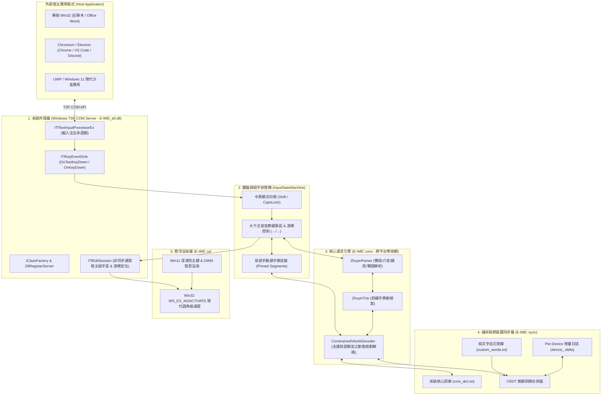

# E-IME (Enhanced IME) 系統架構與工程設計文檔
> **全稱**：基於 MS-IME 的改進型注音輸入法 (Enhanced IME)  
> **代號 / 命名空間**：`E-IME` (`namespace E-IME`)

---

## 1. 專案定位與核心設計目標

**E-IME** 旨在打造一套**「高度貼合微軟新注音肌肉記憶與操作直覺，並改進詞庫維護彈性、反應延遲與跨機自造詞同步機制」**的現代化 Windows 注音輸入法。

### 1.1 核心必備能力 (Core Must-Haves)
1. **貼合微軟注音肌肉記憶 (MS-IME Muscle Memory Parity)**：
   * **整句組字 + 游標回頭改字**：支援在長句組字區（Composition Buffer）中按 `←` / `→` 移動游標、按 `↓` 展開該位置的候選字窗、按 `1`~`9` 或候選窗中的 `Enter` 局部鎖定（Pin）選字，其餘區段重新執行 Viterbi 解碼。選字後保留組字底線，單字、整詞及標點皆能再次改選；候選窗關閉後再按 `Enter` 才送出整句。空白鍵在注音未完成時輸入一聲，其餘情況插入空格，不觸發選字。
   * **Shift 中英無縫切換**：單擊 `Shift` 切換中/英模式；組字中按 `Enter` 直接送出整句；`Backspace` 精準逐碼倒退；`Esc` 瞬間清空組字區（不干擾 Vim / IDE 操作）。
   * **繁簡中文即時切換 (Ctrl + Shift + F)**：內建靜態 OpenCC 高效能對照表（4,148 組標準繁簡映射），切換為簡體輸出時即時以極速（< 10ns/字）轉碼上屏與預覽，候選窗同步標記 `[繁]` / `[簡]`。
   * **智慧中英混打與全形標點**：支援 `Ctrl + ,`（，）、`Ctrl + .`（。）、以及前導引號自動配對。
2. **極致效能與低資源佔用 (Microsecond Latency)**：
   * 常駐記憶體 $< 10\text{MB}$，核心 DLL $< 4\text{MB}$。
   * 單次擊鍵解碼延遲 $< 50\mu s$（$0.05\text{ms}$），避免現代輸入法常見的掉字與卡頓現象。
3. **無鎖跨裝置雲端同步 (Zero-Lock Multi-Device Cloud Sync)**：
   * 採用 **Per-Device Append-Only Delta Journal (`device_<hostname>.delta`)**。
   * 多台 Windows 電腦指向同一個 OneDrive / Google Drive / Git 資料夾時，各設備僅寫入自己的增量檔，讀取時於記憶體做無衝突聯集（CRDT Counter Merge），避免傳統單一資料庫方案在雲端同步時常見的檔案鎖定與衝突副本問題。
4. **現代台灣繁體語料庫 + 純文字即時擴充**：
   * 內建現代台灣常用詞、科技詞彙、網路用語，並支援 `custom_words.txt` 純文字自訂詞庫。

---

## 2. 系統總體架構圖 (System Architecture)



---

## 3. 五大工程侷限性與防禦性設計 (Limitations & Mitigations)

| 工程侷限性 | 現象與風險 | E-IME 的架構應對方案 |
| :--- | :--- | :--- |
| **1. 肌肉記憶恐怖谷** | 微小按鍵行為與 MS-IME 不同（如游標改字後整句跑掉）會導致極度不適。 | 實作 **Constrained Viterbi（受限動態規劃）**：當使用者在長句中段手動選字時，將該區段設為 `PinnedConstraint`，前後未鎖定區段自動重算最佳解，完全復刻微軟新注音核心體驗。 |
| **2. 宿主 TSF 碎片化** | Word、Chrome、VS Code 回報游標矩形 (`GetTextExt`) 偶發失敗或座標為 `(0,0)`。 | 實作 **三級座標回退機制 (3-Tier Caret Fallback)**：優先取 `ITfContextView::GetTextExt` $\rightarrow$ 次取 Win32 `GetGUIThreadInfo` 游標 $\rightarrow$ 保底吸附於作用中視窗左下角內側。 |
| **3. 焦點搶奪導致遊戲/編輯器閃退** | 傳統彈出視窗會搶走宿主 `WM_ACTIVATE` 焦點，導致全螢幕遊戲跳出或選單關閉。 | 候選窗嚴格設定 `WS_POPUP \| WS_EX_TOPMOST \| WS_EX_TOOLWINDOW \| WS_EX_NOACTIVATE`，滑鼠點擊或顯示時**絕對不搶奪宿主焦點**。 |
| **4. 雲端同步檔案鎖定** | 多台電腦同時開啟 OneDrive 同步單一 SQLite 檔案會產生衝突副本或鎖死。 | 廢棄單一 DB，改用 **Per-Device Append-Only Delta (`device_<hostname>.delta`)**。寫入只寫本機專屬檔，讀取時聚合目錄下所有 `.delta`，物理上消除寫入衝突。 |
| **5. 系統沙盒與權限隔離** | Windows 11 UWP / Edge 沙盒預設阻擋未宣告類別的輸入法 DLL。 | 在 `register.cpp` 完整註冊 `GUID_TFCAT_TIPCAP_IMMERSIVESUPPORT`、`SECUREMODE`、`UIELEMENTENABLED` 與 `SYSTRAYSUPPORT` 四大現代分類。 |

---

## 4. 核心演算法：支援局部鎖定的受限 Viterbi 解碼

在微軟新注音中，使用者常先打完一整句（例如：`ㄐㄧㄣ ㄊㄧㄢ ㄊㄞˊ ㄐㄧ ㄉㄧㄢˋ ㄉㄚˋ ㄓㄤˇ` $\rightarrow$ 「今天台積電大漲」），若其中某個詞想換成同音字，會移動游標手動選擇。

E-IME 的 `ConstrainedViterbiDecoder` 定義如下：
* 設輸入音節序列長度為 $N$。
* 使用者鎖定集合為 $P = \{ (s_k, L_k, W_k) \}$，代表從音節 $s_k$ 開始、長度為 $L_k$ 的區間強制鎖定為詞彙 $W_k$。
* 狀態轉移時：
  1. 若位置 $i$ 存在鎖定項目 $(i, L_k, W_k) \in P$，則**強制唯一轉移**至 $i + L_k$，並賦予極高正權重。
  2. 若位置 $i$ 未被鎖定，則枚舉所有不跨越任何鎖定區間內部的候選詞 $w$，計算：
     $$\text{Score}(i \to j) = \text{DP}[i] + \log P_{\text{base}}(w) + \Delta_{\text{user}}(w) + \text{Bonus}_{\text{length}}(j - i)$$
  3. 其中 $\Delta_{\text{user}}(w)$ 來自跨裝置同步層即時合併的個人詞頻加成，使常用詞自動浮上第一候選！

---

## 5. 專案目錄與模組結構

```text
E-IME/
├── docs/
│   └── ARCHITECTURE.md           # 本系統架構文檔
├── engine/                       # [Layer 2 & 3] 跨平台純邏輯核心引擎
│   └── include/
│       ├── zhuyin.h              # 大千鍵盤映射與注音音節解析器
│       ├── trie.h                # 前綴字典樹 + 動態個人詞頻加成
│       ├── viterbi.h             # 支援局部鎖定 (Pinned Override) 的 Viterbi 解碼器
│       ├── dict_loader.h         # 系統詞庫與自訂詞庫載入器
│       └── input_state_machine.h # 完整 MS-IME 狀態機 (Shift/游標/選字/標點)
├── sync/                         # [Layer 4] 無鎖跨裝置雲端同步引擎
│   └── include/
│       └── sync_journal.h        # Per-Device Append-Only Delta 日誌與合併器
├── ui/                           # [Layer 5] Windows 現代候選字視窗
│   ├── candidate_window.h        # WS_EX_NOACTIVATE 懸浮候選窗介面
│   └── candidate_window.cpp      # Win11 圓角、深色主題與 GDI/DirectWrite 高清渲染
├── tsf/                          # [Layer 1] Windows TSF COM 系統外殼
│   ├── guids.h                   # E-IME 專屬 CLSID 與 Profile GUID
│   ├── text_service.h            # ITfTextInputProcessorEx / KeyEventSink 宣告
│   ├── text_service.cpp          # TSF 按鍵攔截、EditSession 組字上屏、游標定位
│   ├── register.cpp              # Windows 登錄檔與 TSF 類別自動註冊/反註冊
│   ├── dllmain.cpp               # COM ClassFactory 與 DLL 入口點
│   └── E-IME_tsf.def              # COM 標準匯出符號表
├── tools/                        # 詞庫生成與維運工具
│   └── build_sample_dict.py      # 台灣繁體現代語料庫建置腳本
├── cli/                          # 終端機互動模擬器與效能基準測試
│   └── main.cpp
├── tests/                        # 完整自動化單元與整合測試套件
│   └── test_main.cpp
├── scripts/                      # 部署與熱重載腳本
│   ├── install.ps1               # 一鍵註冊 E-IME_tsf.dll 至 Windows 系統
│   └── uninstall.ps1             # 一鍵卸載與清理
└── CMakeLists.txt                # CMake 跨目標建置系統 (E-IME_cli, E-IME_tests, E-IME_tsf)
```
