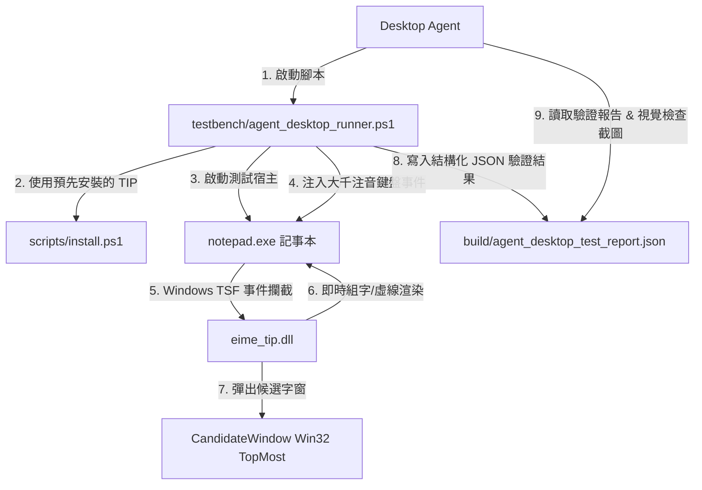

# E-IME 桌面操作代理人 (Computer-Use Desktop Agent) 測試手冊

最新快捷鍵修正：[Ctrl+Shift+1 全形驚嘆號](EXCLAMATION_2026-10-24.md)。

最新補充：[小鍵盤數字保留組字與游標位置](NUMPAD_2026-10-24.md)。

最新狀態請先讀 [按住 Ctrl 連續輸入逗號](REPEAT_COMMA_2026-10-24.md) 與 [選字後重新改選](RESELECT_2026-10-24.md)，逗號封包處理見 [Ctrl+, 逗號組字修復](COMMA_2026-10-24.md)，先前的生命週期處理見 [宿主崩潰修復與驗證](REPAIR_2026-10-23.md)。安裝現在使用獨立版本目錄；舊送鍵腳本不再自行註冊 DLL，報告改存 `build/legacy_key_injection_report.json`。`eime_tsf_lifecycle.exe <absolute-DLL-path>` 涵蓋 COM 卸載與 TSF 回呼生命週期。

本目錄專門為**具備 Windows 桌面操作能力的 AI Agent** 或自動化測試程式設計。Agent 可以利用本套工具鏈，全自動驗證 E-IME (Enhanced IME) 在真實 Windows GUI 宿主應用程式中的敲字、選詞、繁簡切換與游標追蹤。

---

## 1. 測試架構總覽



---

## 2. 核心測試工具與腳本

| 檔案 | 職責 | 執行方式 |
| :--- | :--- | :--- |
| `testbench/agent_desktop_runner.ps1` | **舊版按鍵注入煙霧測試**：啟動 Notepad、送出測試按鍵並生成 JSON；未比對實際文字 | `pwsh -NoProfile -File testbench/agent_desktop_runner.ps1` |
| `build/eime_testbench.exe` | **高並發與壓力測試基準**：測試 22,000 次擊鍵洪峰、8 執行緒雲端日誌無鎖寫入、40 音節 Viterbi、5,000 次混沌模糊測試 | `.\build\eime_testbench.exe` |
| `build/eime_tests.exe` | **13 個核心單元與整合測試模組**：大千映射、Viterbi、同步、TSF COM 伺服器、繁簡轉換、二進位快取與反覆改選等 | `.\build\eime_tests.exe` |
| `scripts/install.ps1` | **系統註冊器**：向 Windows TSF 註冊鍵盤服務、Immersive Mode、全域顯示屬性提供者 | 於系統管理員身分執行 |
| `scripts/uninstall.ps1` | **乾淨反註冊器**：從登錄檔與 TSF 類別管理器完全移除 | 於系統管理員身分執行 |

---

## 3. Desktop Agent 執行步驟指南

當未來的 Desktop Agent 上線時，可直接循以下 SOP 執行驗證：

1. **編譯最新二進位檔**（若尚未編譯）：
   ```powershell
   cmake --build build
   ```
2. **以管理員權限執行安裝**：
   ```powershell
   pwsh -NoProfile -File .\scripts\install.ps1
   ```
3. **執行 Computer-Use 實機驗證**：
   * 使用 computer-use 技能開啟獨立記事本視窗，切換至 E-IME 中文模式。
   * 以實體按鍵事件輸入測試鍵碼（不可直接貼上預期的中文字），建議每鍵間隔 100 ms。
   * 每個案例送出 Enter 後，從記事本編輯區讀取文字，逐項比對預期輸出。
   * 另存 `build/agent_desktop_test_report.json`，記錄 `Expected`、`Actual`、`PASS` / `FAIL` / `BLOCKED` 與受測 DLL 的 SHA-256。

   若只需執行舊版按鍵注入腳本：
   ```powershell
   pwsh -NoProfile -File .\testbench\agent_desktop_runner.ps1
   ```
4. **讀取測試結果 JSON**：
   Agent 讀取 `build/agent_desktop_test_report.json`，確認每個案例的 `Actual` 符合 `Expected` 且狀態為 `PASS`。舊版腳本的 `COMPLETED` 只代表按鍵已送出，不能當成測試通過；舊版報告另存 `build/legacy_key_injection_report.json`。
5. **電腦視覺 (Vision) 截圖驗證（可選）**：
   Agent 可在候選字窗展開時擷取螢幕畫面，驗證候選字窗是否呈現目前的白底淺色樣式、Win11 圓角陰影、以及組字虛線/粗底線是否精準對齊。

最近一次實機驗證與已知限制：[2026-10-23 測試紀錄](TEST_REPORT_2026-10-23.md)。
